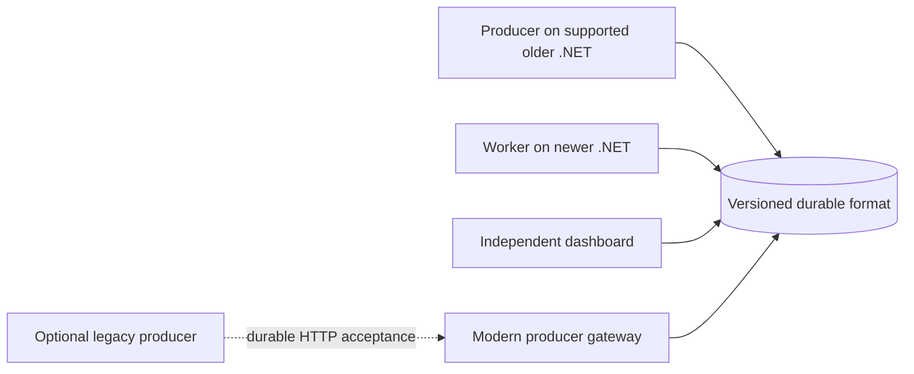

# ADR-005: Runtime support and durable format compatibility

Status: .NET 8 minimum implemented. Runtime packages carry a single net8.0 asset consumed on .NET 8 and .NET 10; no separate net10.0 asset is needed. Package-only consumers were compiled with SDK 8.0.425 and 10.0.400 and executed on runtimes 8.0.31 and 10.0.11. .NET 9 and Framework 4.8 are not part of the executed matrix.

## Context

The application that enqueues work, the workers that execute it, and the dashboard may use different .NET and WorkThrough versions. A package that compiles against several target frameworks is insufficient evidence that those deployments can safely share a durable store.

The user considered .NET Framework 4.8 and .NET 6, then selected .NET 8 as the minimum. Modern .NET and Windows-only .NET Framework have different hosting and dependency constraints; a future legacy bridge remains an optional integration.

## Policy

- Repository orchestration uses SDK 10; samples target net8.0 and may run under a configured newer host.
- Ship net8.0 runtime assets and a netstandard2.0 generator built against Roslyn 4.8 APIs. SDK 8.0.425 is the oldest consumer SDK exercised by this repository. Broader SDK/runtime matrices require additional evidence.
- Document vendor runtime support separately from verified package compatibility. As checked on 2026-10-07, .NET 8 and 9 reach Microsoft end of support on 2026-11-10; .NET 10 on 2028-11-14. Retaining a compatible package asset does not extend vendor runtime support.
- Do not choose .NET 6 as the default engine baseline. It is already outside Microsoft support and the current PostgreSQL driver no longer supports it. Supporting it would require an explicit maintenance and dependency decision.
- Offer .NET Framework 4.8 integration when a concrete consumer needs it, initially as a small producer client or HTTP enqueue gateway. Evaluate a separate `netstandard2.0` client/contracts package; do not move the entire hosting/dashboard stack onto .NET Standard. An HTTP enqueue acknowledgment must follow durable commit and accept a caller idempotency key.
- Treat running legacy handlers inside .NET Framework as a separate worker adapter requirement. A legacy producer bridge does not establish legacy in-process handler support.
- Publish a minimum consumer SDK/compiler version separately from the runtime matrix. A generator targeting `netstandard2.0` is not automatically compatible with every Roslyn host.
- Remove an advertised framework target through a documented breaking release, rather than silently through a transitive dependency update.

## Compatibility boundaries

1. **Public NuGet API:** preserve the supported API surface and target frameworks across compatible releases; compare against a published baseline.
2. **Consumer build tools:** compile a real package consumer using the oldest supported SDK as well as current SDKs. The repository's SDK pin must not accidentally govern that consumer test.
3. **Stored envelopes and payloads:** use explicit format and job-contract versions. Maintain consistent casing, enum/date/number handling, required/null validation, and unknown-field behavior across targets. Never derive wire identity from CLR or assembly names.
4. **Flow definitions:** preserve the exact immutable definition chosen by a run. Automatic revision identity remains a separate proposed refinement; it must be canonical and independent of CLR/runtime details.
5. **Database schema and engine protocol:** define compatible reader/writer ranges. Use reviewed additive migrations for a declared coexistence window. Unsupported workers must refuse to start/claim with an actionable error. Define when rollback remains possible; never assume a down migration can recover information removed by a newer schema.
6. **Handler capabilities:** advertise stable contract versions and engine features separately from the runtime version. Route only to compatible workers; a new feature must not be silently misinterpreted by an older worker.

## Implementation evidence

Core explicitly references System.Text.Json 10.0.12 on both runtimes, preserving required constructor and nullable input validation. The .NET 8 target does not silently drop serializer checks. The release script runs provider tests on both runtimes and a producer on .NET 8 followed by its replacement worker on .NET 10. It compiles package consumers outside the repository SDK pin using fresh package caches.

Schema-1 saved job/flow fixtures are exercised on both relational providers. See ADR-008 for schema-2 rollout: stop old workers before migration, preserve old flow failure semantics, and reject unknown future schemas. This is not a claim that arbitrary historical engine versions can share a store. Windows/Linux/native-dependency coverage still requires the configured CI/platform matrix; the local run is macOS arm64.

## Required release evidence

- Restore and run package-only consumers on every advertised runtime with an isolated package cache.
- Verify generated and explicit registration with the minimum supported consumer compiler.
- Enqueue on an older supported runtime, execute on a newer one, and inspect from a dashboard without application DLLs. Exercise reverse directions only where explicitly promised.
- Preserve golden persisted-job and flow fixtures across engine releases, including non-null/required validation and versioned payloads.
- Test mixed supported engine versions sharing one store during migration; test rejected incompatible combinations and documented rollback paths.
- Run provider conformance on each supported backend and a targeted OS/architecture matrix for native dependencies.

## Alternatives and consequences

Keeping only .NET 10 is simpler but excludes existing modern applications. Making the entire engine .NET Standard broadens its nominal API reach while complicating hosting, dependencies, and runtime verification. Supporting every historical runtime multiplies maintenance and test combinations. The proposed modern engine plus optional legacy producer bridge preserves a small deployment surface while leaving a deliberate route for older applications.

## Sources

- [Microsoft .NET support policy](https://dotnet.microsoft.com/en-us/platform/support/policy)
- [Microsoft library targeting guidance](https://learn.microsoft.com/en-us/dotnet/standard/library-guidance/cross-platform-targeting)
- [System.Text.Json 9 validation settings](https://devblogs.microsoft.com/dotnet/system-text-json-in-dotnet-9/)
- [Npgsql 10 compatibility changes](https://www.npgsql.org/doc/release-notes/10.0.html)
- [Roslyn guidance on analyzer/compiler compatibility](https://github.com/dotnet/roslyn/discussions/81256)
