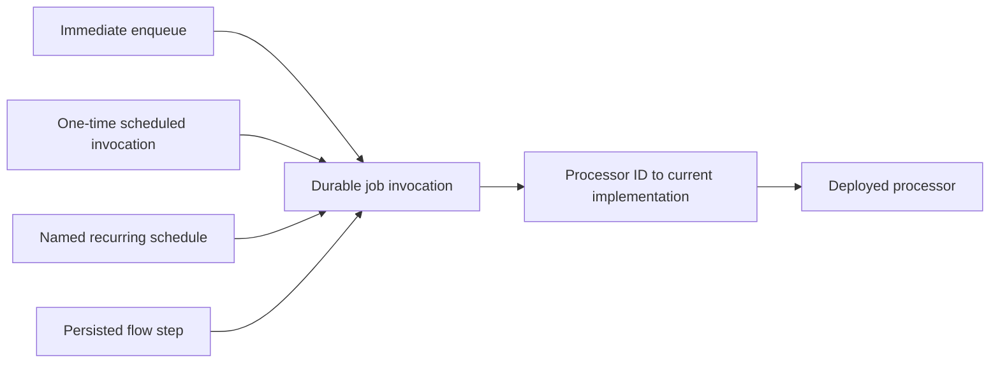

# ADR-006: Processor identity, job executions, and schedules

Status: direct processor identity, raw/typed input, shared generated/explicit dispatch, and durable recurring processor schedules implemented. See verification.md and scheduling.md for executed checks and boundaries.

## Context

The user's processor accepts a string, deserializes it internally, and executes business logic. Its class may move between namespaces, assemblies, projects, or solutions. In their previous system, scheduled invocation metadata required custom migrations after those moves. Several processors may also accept the same CLR input type.

An identity on the request DTO alone is insufficient as the only public addressing mechanism for this use case. Processor identity must be directly expressible and independent of the payload's CLR type.

## Decision

- **Processor:** reusable executable behavior with an explicit permanent `ProcessorId`. Generated registration maps it to the deployed implementation. Changing its class, namespace, assembly, or display label preserves its identity.
- **Job:** one durable invocation of a processor, with a unique JobId, input, queue, timing, correlation, retry policy, and attempts.
- **Schedule:** a durable named trigger that creates job executions or starts a flow. Its ScheduleId is independent of its target processor/flow and the resulting execution IDs.
- **Flow step:** one node in a saved flow definition, targeting a logical processor invocation contract rather than a CLR implementation.

The same processor can run immediately, after a delay, at a specified instant, from a recurring schedule, or as a flow step. It should not need a separate scheduled-handler base class. Payloads may be typed DTOs or strings. Typed registration can provide compile-time convenience while stored dispatch remains independent of CLR names.

The invocation contract version describes compatibility of input, output, and operation semantics. It is not an assembly version and does not change solely because a processor moves. The direct API must support two processors accepting the same CLR input type without collapsing their identities.

## Scheduling semantics

One-time scheduling specifies a UTC instant or delay. Recurring scheduling additionally needs a time zone, overlap policy, missed-occurrence policy, enabled state, and a persistent next occurrence. Job execution times are eligibility times rather than guarantees of exact start times under load.

Schedule registration/update must have a defined owner and reconciliation policy. Starting multiple hosts must not create duplicate schedules or let an old deployment silently overwrite a newer definition. Claiming a due occurrence, creating its logical execution, and advancing its occurrence state must be atomic or idempotently recoverable. Failed scheduler processes must not silently lose occurrences.

Permit several schedules to invoke the same processor with different inputs. Deleting or pausing a schedule must have an explicit policy for executions it already created. Retry of an existing execution must not manufacture another schedule occurrence.

No implementation class, method reflection signature, closure, or assembly-qualified name becomes durable dispatch identity. Historical handler names can remain in attempt diagnostics.

## Acceptance evidence required

1. Enqueue and schedule a string payload for processor A; register processor B accepting the same string type and prove each invocation selects its intended processor.
2. Publish build A without executing its scheduled job. Move and rename the processor into another assembly, remove the old assembly, then publish build B and execute the unchanged saved invocation after it is due.
3. Repeat the relocation for a persisted flow step and, once supported, a recurring schedule target.
4. Compare persisted processor identity and payload before/after relocation; no job metadata migration or historical CLR-name resolver is permitted in the proof.
5. Reject conflicting processor registrations before acquiring work. Preserve queued work when no capable worker is deployed and expose the reason.
6. Run the examples through locally packed NuGet packages on the accepted .NET 8 minimum.

## Alternatives and consequences

Request-type-only dispatch remains convenient for message-oriented code but cannot be the sole addressing API. Persisting CLR invocation metadata recreates the user's migration problem. Guessing replacement processors from similarly named types cannot establish compatibility.

Explicit logical keys require one deliberate naming decision, then remain stable through refactors. Renaming a key is a contract migration; changing a human-readable label is not. Moving between solutions still requires the replacement worker to deploy and register the new implementation.

The refactor sample now includes direct raw-string identity, a future-due invocation, and a saved flow step, alongside the original typed request proof. It removes the original processor assembly and checks unchanged keys and inputs across .NET 8 to .NET 10.
