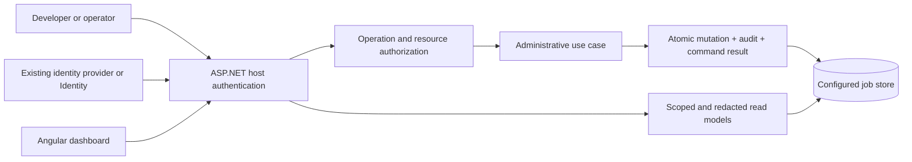

# ADR-007: Dashboard authentication, permissions, and administrative audit

## Status

Implemented in the local alpha. The detailed proposal below is retained as decision history; current APIs and tested boundaries are in `docs/dashboard-security.md` and `docs/verification.md`. Live OIDC account login remains deployment-specific.

Proposed implementation direction, 7 October 2026, following the user's request for authentication, user management, and attribution of administrative actions. Basic host authentication and anti-forgery validation already exist. Fine-grained permissions, account integration samples, and durable administrative audit are not implemented.

WorkThrough is the accepted working product name. Existing source namespaces, APIs, NuGet IDs, and the earlier Angular concept still use their previous names pending a coordinated rename. This ADR does not describe available package APIs.

## Context

The dashboard can live inside an API, an HTTP-enabled worker, or a separate ASP.NET host. Requiring another user database inside every embedding application would complicate adoption, account lifecycle, SSO, and security maintenance. Authentication alone does not determine whether a user should see payment inputs, retry a processor, or change fleet concurrency.

Current behavior is narrower than the desired product:

- `MapWorkThroughDashboard` uses one named host policy, or the host's default authorization policy, for every dashboard endpoint. With the standard default policy, any authenticated principal can read details and request available mutations.
- Retry and cancellation validate anti-forgery tokens, then call storage directly. They do not persist the user's identity, action reason, or an administrative audit event.
- The sample hosts permit anonymous use in Development and otherwise require the maintainer to configure authentication. `AllowAnonymous` is an explicit bypass; the library currently does not enforce an environment check on this option itself.
- The Angular concept served on port 5295 is static fictional data with no engine API connection, identity integration, or real recovery commands.

## Decision

### Identity belongs to the host

For an embedded dashboard, reuse the application's authenticated principal and map its roles/claims into WorkThrough permissions. Do not install a user/password schema as a side effect of installing the dashboard NuGet.

For a standalone dashboard, supply an executable OpenID Connect sample using server-managed sessions. The identity provider owns account creation, password recovery, MFA, disabled accounts, and group membership. An application already using ASP.NET Core Identity can compose the same dashboard without a separate identity provider.

Keep browser identity at the ASP.NET host boundary. In the standalone OIDC sample, the server completes authorization-code authentication and keeps credentials/tokens out of Angular application storage; Angular calls same-origin APIs with the session cookie and an anti-forgery token for writes. API hosts using bearer authentication may configure a separate cookie/OIDC scheme for the dashboard. Do not silently replace their default authentication schemes or authorize browser access merely because an API has JWT services registered.

Document secure cookie/TLS settings, callback/logout paths under the chosen mount path, redirect validation, data-protection key persistence/sharing for replicated hosts, session expiry, and permission refresh/revocation. Define an explicit maximum revocation delay and a host validation hook; signing in once must not grant permanent rights after an account or group changes.

Full local account management is deferred until a concrete offline/standalone deployment requires it. If needed, provide it as a separate sample/optional host built on ASP.NET Core Identity. Do not implement custom passwords, recovery tokens, or cryptography in the engine.

### Permissions belong to the operation

Use ASP.NET policy-based and resource-based authorization. Roles are convenient permission bundles, not hardcoded assumptions about an identity provider's role names. Apply a base dashboard-access requirement plus the operation's explicit permission. Missing permissions deny access.

Proposed permission vocabulary:

| Permission | Access |
|---|---|
| `executions.read` | Authorized execution metadata, state, queue, timings, and flow graphs |
| `payloads.read` | Authorized inputs/outputs and sensitive diagnostic detail; separate from metadata access |
| `jobs.retry`, `jobs.cancel` | Corresponding standalone job commands |
| `flows.recover` | Explicit, state-validated recovery commands once implemented |
| `schedules.manage` | Schedule creation/update/pause/resume once implemented |
| `limits.manage` | Shared concurrency and admission policy changes |
| `audit.read` | Authorized administrative history |
| `access.manage` | WorkThrough permission assignment changes only if a runtime assignment store is added |

Suggested default bundles are Viewer (metadata), Operator (metadata and explicitly enabled execution commands), Administrator (configuration permissions), and Auditor (audit history). Payload visibility is an explicit additional grant. Administrator does not automatically imply unrestricted business-payload access. Authentication with no mapped grant confers no dashboard access in the new model.

The first version maps existing claims/groups through host configuration. A future access-management screen may manage application grants, but must not pretend to own external accounts. If grants become persistent, scope and audit changes, require explicit `access.manage`, and prevent unintended self-escalation. Do not invent a second user directory just to display an operator's name.

Check permission and resource scope on the server for every read and write, including direct requests that bypass the UI. All list/count/export/graph/trace-link endpoints need the same scope filtering as detail routes. Do not fetch an entire job with sensitive payloads merely to hide fields in Angular. Use distinct safe read models. Error strings and stack traces can also disclose payload data.

Start with one explicitly configured environment/store per dashboard host. Multi-tenant or multi-environment access requires a persisted scope model and provider query enforcement before being advertised. Tenant IDs, queue names, and correlation IDs supplied by a caller are not proof of authority; `CorrelationId` never becomes an access boundary. Future tenant-aware mutations must verify ownership inside the state-changing transaction as well as at the request boundary.

### Administrative changes have durable attribution

Execution attempt history explains what workers did. Administrative audit explains what a person or service requested. Keep these concepts related but distinct.

An audit entry includes:

- An immutable event ID and database UTC time.
- Actor kind (`user`, `service`, or `system`), stable subject and issuer from a trusted authentication mapping, and an optional display-name snapshot. Email/display name alone is not durable identity.
- Action and target identity: environment/store, job/run/step/schedule/policy as applicable.
- Command ID, request/trace ID, relevant correlation/causation IDs, and a required reason for recovery or policy changes.
- Expected and resulting state/revision; an allowlisted, redacted change summary; command outcome.

For dashboard commands, derive the actor from the authenticated principal on the server. Ignore any actor, role, tenant authority, or audit timestamp supplied by Angular. Background services identify a trusted service/system actor. Preserve original requester attribution separately from the worker identity; do not retain a user's bearer token in a durable job or implicitly impersonate that user when a scheduled job eventually executes.

Create focused administrative use cases, such as retry-job, cancel-job, and change-limit. HTTP/CLI adapters authorize and supply trusted actor context; the use case validates state and invokes a provider operation that commits the mutation, audit event, and command-id result atomically. The provider must not apply the change if the successful-action audit cannot commit. Never implement attribution as only a controller log written after the database change.

Command deduplication uses a scoped command ID and validated request fingerprint. Retrying the same command returns its original result and does not repeat the action/audit change. Conflicting reuse fails. A timeout or lost response may be an ambiguous outcome; expose a way to look up the command result. A cancellation audit must say that cancellation was requested/applied to engine state, not assert that an external effect or non-cooperating handler stopped immediately.

Denied requests, invalid tokens, failed commands, and login events are security/operational events. Record them separately with appropriate identity and without pretending a successful state change occurred. A storage outage may prevent a durable failure event, so document the operational log/export fallback. Transactionally audited successful changes must not depend on delivery to a remote logging service.

Append-only means no ordinary product edit/delete API for audit events. It does not make records immune to a privileged database administrator. Define retention, authorized archival, and optional external export separately; retention actions themselves require attribution. Payloads, secrets, cookies, and tokens are excluded from audit records. Privileged payload reads/exports should emit access events according to host policy; do not generate an audit write for every harmless status poll.

### Preserve the library boundary

Core has no dependency on HTTP, cookies, `ClaimsPrincipal`, ASP.NET Identity, or an OIDC vendor. It may own plain actor/audit/command records and the transactional persistence contract. The dashboard/hosting adapters translate authenticated context at the boundary. Direct database access and low-level provider calls are trusted infrastructure access, not automatically protected by HTTP policies; document that boundary and route product administration through audited use cases.

## Acceptance evidence required

1. Anonymous access is challenged; authenticated principals with no grant are forbidden; a Viewer cannot retry/cancel/change limits using direct HTTP requests.
2. Metadata-only access reveals no input/output or sensitive exception content through lists, details, graphs, counts, exports, or audit summaries.
3. Embedded and standalone identity samples run without processor DLLs. Test host mount paths, session expiry/revocation, and read/write behavior under configured schemes.
4. An actor submitted in the command body cannot override the authenticated actor. Users sharing a display name remain distinguishable by trusted issuer/subject.
5. For both real storage providers, injected audit-insert failure rolls back the administrative change; concurrent and duplicate command submissions produce one accepted change.
6. A lost command response can be reconciled by command ID. Stale expected revisions fail without modifying state or reporting success.
7. User and service actions produce filterable audit entries with reason and redacted changes. Cancellation wording remains consistent with cooperative execution.
8. Anti-forgery failures make no mutation, authenticated access fails closed when configuration is missing, and production samples never enable anonymous administration by default.
9. If scoped grants are supported, attempts against another tenant/environment are denied for both collection queries and known resource IDs; grant revocation follows the documented interval.
10. Angular capabilities improve presentation but never authorize a server command. Recovery/audit screens use actual persisted results, not prototype fixtures.

## Alternatives and consequences

**One dashboard-wide policy** remains useful as the alpha access gate, but grants too much for mixed viewers/operators and does not supply actor attribution.

**Mandatory built-in users** would offer a self-contained login page at the cost of duplicated identity lifecycle, migrations, and password/MFA maintenance. Host identity is the pragmatic default for a NuGet library; standalone identity composition remains possible.

**Logging middleware alone** is easy to add but cannot prove which state change committed or prevent a missing audit record after a crash. Atomic audit makes provider operations more involved and needs migration/fault-injection tests, but gives a reliable action history.

**Engine-wide event sourcing** is unnecessary for this requirement. Focused append-only administrative records and a separate workflow journal meet different needs without rewriting all state persistence.

## References

- [ASP.NET Core policy-based authorization](https://learn.microsoft.com/en-us/aspnet/core/security/authorization/policies?view=aspnetcore-10.0)
- [ASP.NET Core OpenID Connect web authentication](https://learn.microsoft.com/en-us/aspnet/core/security/authentication/configure-oidc-web-authentication?view=aspnetcore-10.0)
- [ASP.NET Core anti-forgery protection](https://learn.microsoft.com/en-us/aspnet/core/security/anti-request-forgery?view=aspnetcore-10.0)
- Existing implementation: `src/WorkThrough.Dashboard/DashboardEndpoints.cs` and `tests/WorkThrough.Tests/DashboardTests.cs`.

The sources describe framework mechanisms. Permission names, role bundles, audit semantics, and release criteria above are proposed WorkThrough product decisions.
