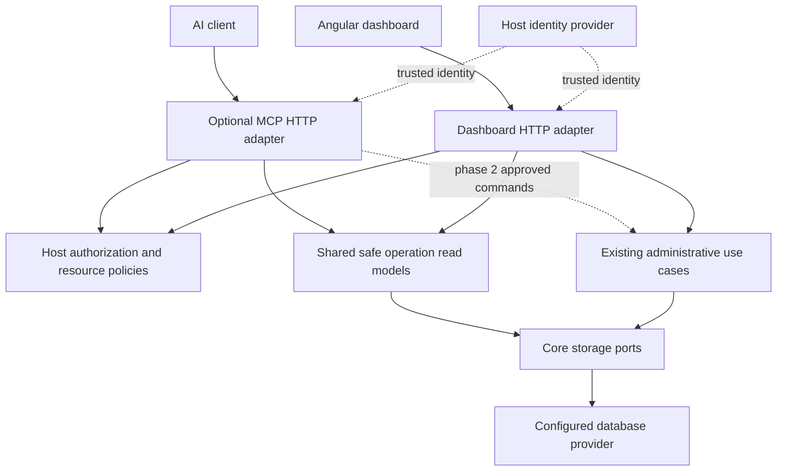

# ADR-011: optional MCP operations adapter

Status: proposed, 2026-10-08. Read-only first and administrative actions later are maintainer-selected scope. Implementation details and budgets remain proposed.

## Context

Operators need to trace correlation IDs, inspect failures, understand blocked flows and assess deployment coverage from AI clients. Existing Core diagnostics and administrative contracts supply much of the evidence. Current dashboard projections/policy resources are transport-specific, and several storage reads lack the filters, bounds and metadata-only projections needed for agent-driven investigation.

## Decision

Add an optional `WorkThrough.Mcp` ASP.NET Core adapter using the official C# MCP SDK. Keep the engine, stable processor identities, storage transactions and dashboard independent of the protocol and of any model provider. Expose a small set of typed investigative tools first. Add actions only through the established administrative use cases with explicit host authorization and trusted approval.

The diagram shows runtime calls; package references remain inward. Core contains no MCP, ASP.NET, database driver or model SDK reference. Framework-free projections/resource identities belong with operation contracts; adapters map the host principal and preserve existing dashboard policy extension points.

The composition root owns authentication, endpoint path, public dashboard URL and one store/environment. HTTP hosting is explicit even in a worker application. Use metadata-first responses, separate payload access, bounded queries and access events. Read-only mode does not register administrative tools and rejects direct calls to them. Tool annotations are client hints, not authority; see the [MCP tool contract](https://modelcontextprotocol.io/specification/2026-07-28/server/tools).

Phase 2 binds approval to the exact action, actor, store, arguments, expiry and state preconditions. It reuses transactional command receipts and successful-action audits. Approval and engine concurrency checks solve different problems; both are necessary. Add missing compare-and-set contracts before exposing affected commands.

## Alternatives and trade-offs

| Option | Assessment |
|---|---|
| Let agents query SQL directly | Bypasses portable read contracts, redaction and resource policy; tightly couples clients to schema |
| Automatically expose every dashboard endpoint as a tool | Exposes unsuitable payloads and commands; current reads and route-based policies need explicit adaptation |
| Route MCP through dashboard HTTP internally | Adds cookie/CSRF and network coupling; requires dashboard hosting for a headless integration |
| Put an LLM inside the worker | Couples durable execution to a model and its credentials without improving deterministic diagnostics |
| Separate operations microservice required for all users | Adds deployment burden; a separate host remains an optional composition of the same package |
| Optional adapter over focused shared operations | Chosen; preserves existing execution semantics but requires query/projection and authorization work |

MCP support adds protocol/client compatibility, authentication configuration and another data disclosure surface. Bounded metadata reads, tested permission equivalence, explicit sensitive reads and real-client tests address those costs. SQL Server/Oracle support remains a provider concern; the adapter cannot compensate for weaker provider guarantees.

## Consequences and release gates

The first release can investigate incidents but cannot retry, cancel, archive or delete jobs. It needs no application handler assemblies and no Angular assets. It must still respect host data policy when sending metadata to an AI client.

Freeze tool schemas and publish a tested SDK/protocol/client matrix. Run .NET 8/10 package consumers and provider contention tests. Preserve at-least-once execution, immutable flow revisions and existing audit guarantees. The complete proposed tools, EARS requirements, budgets and acceptance tests are in [MCP operations](../../specs/mcp-operations.spec.md).
