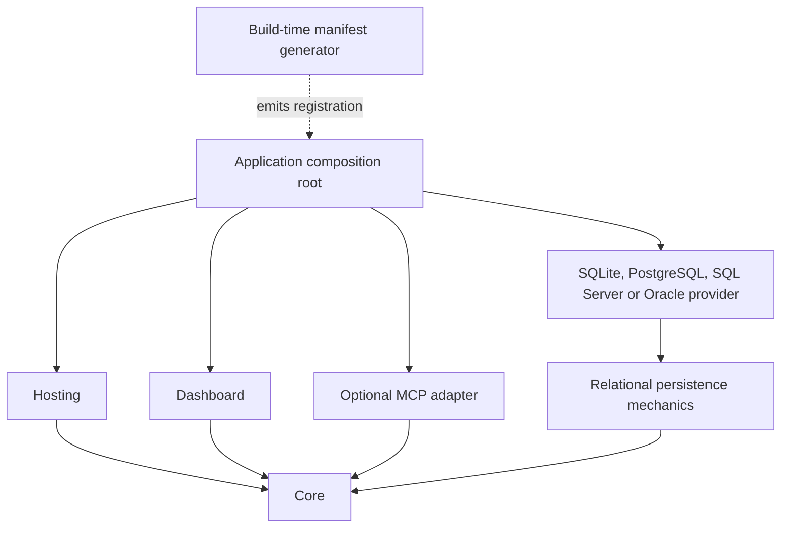

# Architecture

Status: initial implementation; see `plan.md` for release gates and deliberate gaps.

## Dependency rule

Core owns stable identities, handler contracts, the pure workflow transition planner, enqueue/start use cases, and the persistence ports. It has no dependency on ASP.NET, hosting, database drivers, or an ORM. Read models are separated from atomic write operations because dashboard deployment and storage semantics require different capabilities. There is no mediator dependency and no generic application repository.

The relational adapter shares data mapping and transactional operations. Each database provider must supply a real connection, a database clock, and a transaction that serializes admission writes. The first implementation favors correctness and explainability over maximum write throughput.

## Assembly moves

A job contains a stable key, contract version, JSON input, and operational metadata. It never uses a persisted CLR type, assembly name, or method to dispatch work. `[Processor("documents.generate", Version = 1)]` identifies processor behavior independently of its input type. `[JobContract]` remains a typed-message convenience through the same catalog.

The optional generator exports a module manifest from each processor assembly and composes referenced manifests into the application manifest. `AddGeneratedJobs(typeof(Program).Assembly)` registers those modules through the same `JobCatalog` API used by explicit `AddProcessor<TInput,TProcessor>()` / `AddJob<TJob,THandler>()`. Rebuilding updates the manifest. The application still needs a project/package reference to the new processor assembly, and the new artifact must be deployed.

The generator requires public, concrete, non-generic, top-level processor/handler classes or record classes. It diagnoses missing processor/contract attributes and inaccessible implementations. Duplicate contract implementations are rejected when the catalog is composed. Worker startup resolves each handler in a DI scope before claiming work, detecting missing dependencies in the actual deployment.

Handler names and assembly versions appear only in attempt diagnostics. They are not consulted by scheduling, queries, dashboards, or recovery. Old attempt diagnostics remain historical. Producer and dashboard hosts do not need handler assemblies.

Changing JSON structure or business meaning incompatibly still requires a new contract version or an explicit adapter. Legacy Hangfire invocation import and contract upcasters are planned; stable identity alone does not infer arbitrary old-to-new payload conversions.

## Hosting roles

`AddWorkThrough` provides enqueue/start clients and storage initialization. `AddWorker` starts processing through `BackgroundService`. `MapWorkThroughDashboard` hosts UI and administration endpoints at a chosen path. Each role is independently optional.

- An API can enqueue work and host the dashboard while separate workers execute it.
- A generic .NET host can execute jobs with no HTTP listener.
- A worker process can use an ASP.NET host to add an HTTP dashboard.
- A dashboard-only host depends on stored read models, not application contracts.

The .NET host owns address/port/TLS and authentication. The dashboard defaults to requiring host authentication, checks separate action/resource policies and payload permission, and protects all operator mutations with anti-forgery validation. Administrative writes, deduplication receipts, and attributed audit entries share the provider transaction. Anonymous mode is an explicit development option.

## Execution semantics

1. Enqueue commits before acknowledging acceptance. An ambiguous commit result can still require caller reconciliation; a caller idempotency key makes repeating the enqueue safe.
2. Claim uses a short transaction and provider-specific write serialization to recover expired work, check limits, select a supported contract/queue, issue a fresh ownership token, and record an attempt.
3. The worker resolves a scoped handler, records diagnostic implementation metadata, and invokes it outside the storage transaction.
4. A renewal loop extends ownership every third of the lease. A refused renewal means ownership is lost and requests cooperative cancellation; a failed renewal is retried while the lease can still be valid, so a brief storage outage does not abandon healthy handlers.
5. Completion/failure is accepted only for the current unexpired token. Completion and any workflow advancement commit together.

Execution is **at least once**. A process can perform an external effect and die before saving success. `JobExecutionContext.IdempotencyKey` identifies the logical job across attempts. External services or application transactions must enforce effect deduplication; engine deduplication is not an external exactly-once guarantee.

Shutdown stops acquisition and asks executing handlers to cancel. Cooperatively interrupted attempts, including interruption during setup, are recorded and requeued without consuming their retry budget. Active tasks are tracked by lease identity, so a replacement attempt does not collide with a revoked attempt that has not stopped yet; both count against local capacity until they return. Non-cooperating code may outlive host deadlines; process termination falls back to lease recovery. The runtime never force-aborts a thread.

## Concurrency

Local controls bound one worker: total capacity and per-job-key capacity. Shared controls bound the fleet: total and per-job-key admission, keyed limits per partition key or tenant, rate limits and flow parallelism (ADR-018). Per-job limits cover all versions of a stable key. Correlation IDs are not locking keys.

All applicable limits must admit an attempt. Throttled work stays queued and consumes no handler slot. Shared policies reside in `dj_limits`; `SeedClusterLimits` inserts missing defaults without overwriting operator changes. `SetLimitAsync` is the explicit update operation. Zero pauses admission; lowering a limit lets existing work finish and prevents new admission until capacity is available.

Shared limits count valid leases. No lease-based engine can guarantee that a partitioned process has physically stopped executing when its lease expires. Fencing prevents stale storage settlement, not arbitrary remote effects. Administrative shared-limit changes are audited. Keyed limits cap running attempts per `PartitionKey` or `TenantId`, rate limits cap attempt starts per sliding window (optionally per key), `MaxParallelSteps` bounds one flow run's concurrent steps, and competing queues are ordered by weighted stride scheduling; all are evaluated in the same claim transaction (ADR-018). With an `ITenantAccessResolver`, tenant IDs also scope dashboard and MCP access (ADR-019).

## Workflows

The builder produces a data-only acyclic graph of stable step IDs, contract identities, JSON input templates, input bindings, dependencies, and equality conditions. It does not serialize delegates. Every run references an immutable definition version. Republishing changed content under the same version fails.

Step states and outputs are persisted. Success activates eligible successors in the same transaction. Conditions are evaluated from persisted outputs and selected/skipped states are retained. Dependency joins wait for all predecessors to terminate; all must have succeeded or been deliberately skipped, and at least one predecessor must have succeeded. A skipped single predecessor skips its downstream chain. New graphs default to Suspend: terminal attempt failure creates an Incident and leaves dependent work waiting. Operator recovery preserves successful predecessors and attempt history. Stop policy retains terminal fail-and-skip semantics for schema-1 graphs; terminal runs never requeue siblings. Paused/incident runs stop admission while owned siblings may settle.

Initial support includes sequences, conditional branches, parallel roots, dependency joins, and output-to-input property mappings. Durable one-shot signals and timeouts are implemented. Arbitrary expressions, loops, child flows, compensation, and checkpoint forks are planned. Failed incident steps use the separate RecoverStep command with expected attempt, trusted actor, and idempotency. They are never retried through the standalone job endpoint.

## Observability and state

`CorrelationId` groups unrelated runs and jobs. `WorkflowRunId` identifies one run. `StepId` identifies its definition node. `JobId` identifies one logical execution; attempt numbers identify tries. None of these substitute for an enqueue idempotency key.

The dashboard reads JSON and recorded metadata without application deserialization. It filters executions by correlation and state, shows attempts and effective shared limits, and provides standalone retry and cancellation. Saved flow diagrams, transactional event timelines, worker capabilities, and attempt tracing are implemented. Deployment preflight compares a read snapshot of required processor/version/queue combinations with the complete proposed fleet. The dashboard compares the same inventory with recent heartbeats. Bounded archives, separate receipt retention and windowed attempt metrics are implemented. Arbitrary engine/semantic deployment compatibility remains unsupported.

## Lifecycle, diagnostics, and schedules

Draft definitions live separately from the immutable graphs pinned by runs. CAS revisions protect editing/publication; retiring rejects new starts. Schema 2 adds lifecycle, command/audit, diagnostics/progress, worker observations, events, and schedules without replacing stored processor keys or payloads. See ADR-008 for rollout and rollback boundaries.

Attempt errors retain protected exception details; progress/deadline observations never redefine lease ownership. The worker exposes standard ActivitySource/Meter instrumentation with bounded metric dimensions. Saved diagrams and event timelines use database read models rather than deployed handler assemblies.

Recurring schedule lifecycle is independent of enable/pause admission. Cronos calculates five-field cron occurrences in an explicit time zone; provider transactions create occurrence/job/next-due state atomically. See scheduling.md for overlap and misfire policies and current processor-only targets.

## Schema-3 operations

Typed definitions/manual registration, coordinated aliases with shared admission, middleware/validation/retry policies, durable subscriptions, business transaction/outbox acceptance, signals, queue controls, replay, and bounded archival are implemented. See ADR-010, `identity-evolution.md`, `processor-lifecycle-and-extensibility.md`, and `operations-and-retention.md` for current contracts. The original design notes above remain useful context; these guides supersede earlier statements that those features were only planned.

Schema 4 adds opt-in fenced retention maintenance, whole-unit holds, persisted policies, verified directory exports and bounded journal cleanup. See [ADR-013](adr/0013-fenced-retention-maintenance.md) and the operations guide. Older writers must stop before upgrade; active flows remain in one store. Schema 5 adds the admission controls of ADR-018 additively. SQL Server and Oracle implement the same engine operations through the provider boundaries below.

SQL Server uses the shared state transitions with provider-owned schema/JSON projections, small SQL-fragment seams, transaction-owned application locking and snapshot inspection. Its explicit key bounds and trailing-space restriction are recorded in [ADR-014](adr/0014-sql-server-storage.md). Business transaction callbacks retain the original ADO.NET connection and SQL dialect.

Oracle uses a schema-local admission row lock, Serializable inspection and checkpointed initialization under a DDL-surviving session lock. Its explicit text/credential/DML-only restrictions are recorded in [ADR-015](adr/0015-oracle-storage.md).

Immediate client envelopes use the destination database clock on acceptance, including outbox delivery; explicit not-before instants retain their precision. See [ADR-016](adr/0016-immediate-acceptance-clock.md).
