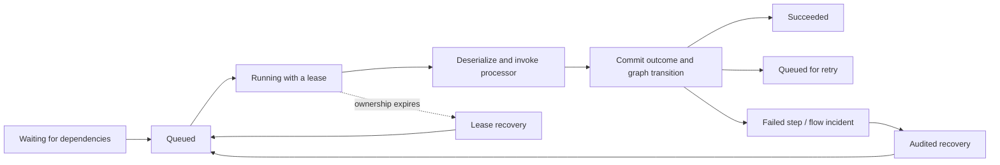

# Typed processors, lifecycle, and execution extensions

Status: exploration requested on 2026-10-08. Typed input and the state transitions marked implemented below exist today. Public filter/middleware APIs in this document are proposals, not installed package features.

## Typed input: keep IProcessor<T>

The existing interface takes `TInput input`, `JobExecutionContext context`, and `CancellationToken`. It does not require an engine-owned message base class. Prefer a concrete record/class DTO for application work; `string` preserves the caller's raw text, while `JsonElement` is useful for integrations with runtime-selected JSON. Serializable value types can also be inputs. A generic C# constraint cannot prove that a type has a compatible JSON representation.

```csharp
public sealed record GenerateInvoice(Guid InvoiceId);

[Processor("invoices.generate", Version = 1)]
public sealed class GenerateInvoiceProcessor : IProcessor<GenerateInvoice>
{
    public Task<JobResult> ProcessAsync(
        GenerateInvoice message, JobExecutionContext context, CancellationToken ct)
        => Task.FromResult(JobResult.From(new { message.InvoiceId, generated = true }));
}
```

The input DTO needs no `[JobContract]` when the processor has its own identity. Another processor can accept the same DTO. Producers can pass the stable key explicitly without referencing the processor assembly. The package-consumer smoke exercises typed DTO and raw-string processors through generated registration.

Do not use `object` or an interface as an automatic dispatch switch, or save assembly-qualified names to select a runtime subtype. A polymorphic input needs an explicit, stable JSON discriminator/converter contract. There is currently no per-processor serializer configuration API. Null inputs are rejected. Required constructor/non-null validation is exercised on both supported runtimes; domain validation is separate. Generator-discovered processor implementations must be concrete, public, top-level, and non-generic; this does not prevent their input from being a generic serializable DTO.

Typed output is a useful later convenience (`IProcessor<TInput,TOutput>`), provided it uses the same registry and persists plain JSON. It should not become a second dispatch engine. Dynamic flow edges would still need explicit schemas/version validation; compile-time types cannot validate an arbitrary saved graph.

## Four lifecycles, each with a distinct purpose

| Lifecycle | Implemented behavior | Remaining work |
|---|---|---|
| Definition | Draft → Published → Retired; published versions immutable | Richer authoring and canonical revision options |
| Logical job | Waiting, Queued, Running, Succeeded, Failed, Skipped, Cancelled; future-due/retry work remains Queued with a reason | Explicit rejection/expiry outcomes and configurable retry classification |
| Attempt | Running followed by succeeded/failed/interrupted/expired/cancelled evidence; every retry records a new attempt | Public observer extension points |
| Flow run | Running, Paused, Incident, Succeeded or terminal Failed under saved policy | Run-level cancellation, validated correction, checkpoint fork, compensation, durable signals/child flows |

A processor instance has a separate DI lifetime: a scope per attempt, disposed after settlement handling. Do not keep durable progress in processor instance fields. A new attempt can run on another machine. Cancellation is cooperative, and a live heartbeat does not prove progress.



The sketch omits terminal Stop-policy branches. Draft belongs to a definition, never to an executing attempt. User-requested cancellation, host shutdown, a deadline, and lost lease ownership must remain distinguishable.

## What Hangfire and Wolverine suggest

[Hangfire filters](https://docs.hangfire.io/en/latest/extensibility/using-job-filters.html) expose client creation, server execution, and state-election/application stages, with global and attributed registration. That confirms demand for execution customization, but does not require us to adopt its stored method identity or every extension shape.

[Wolverine middleware](https://wolverinefx.net/guide/handlers/middleware.html) supports selective middleware around handlers, including before/after/finally conventions. Its documentation explicitly distinguishes handler completion from transaction commit and provides after-commit behavior. For WorkThrough, that distinction must be visible rather than hidden behind a generic `OnSuccess` callback.

## Recommended extension design

Keep these contracts separate and introduce them in this order:

1. **Scoped attempt middleware** around deserialization/processor invocation for logging scopes, validation, tenant-context setup, and tracing enrichment. Add a typed validation adapter after deserialization. Explicit registration order; first registered is outermost. Target stable processor IDs or an input type at registration time. No runtime namespace convention, persisted middleware type, or static global registration list.
2. **Retry policy** returning a structured decision: retry after a delay or exhaust the attempt budget. Built-in bounded exponential backoff/jitter remains the default. Invalid input, business rejection, and transient infrastructure problems should not all consume the same automatic retries. Unknown settlement outcomes must fall back to reconciliation/lease ownership, not pretend the processor failed.
3. **Post-settlement observers** for best-effort local logging/metrics. Expose the committed status and attempt identity. Observer failure must not change an already committed success or rerun the processor. A crash can prevent notification; document this explicitly.
4. **Durable lifecycle subscriptions** backed by transactionally persisted events/outbox plus subscriber checkpoints and deduplication. Use these for business notifications and integrations that must survive crashes. The current event timeline is not yet a public, reliable delivery subscription API.

The initial middleware contract should require exactly one awaited continuation call on successful execution. Throwing before the continuation rejects the attempt; arbitrary short-circuit success, repeated continuation calls, and swallowed cancellation would be errors. Explicit defer/skip/reject behavior should arrive later as validated engine outcomes, rather than allowing a filter to fabricate success. This keeps the existing lease and graph state machine authoritative.

Middleware executes outside the engine storage transaction and inherits the attempt's cancellation/deadline. Its side effects can repeat. Do not hold the admission lock while calling user code. A database transaction opened by middleware is not automatically atomic with WorkThrough settlement or external HTTP calls; business outbox integration remains a separate requirement.

Avoid overridable `Before/After/OnError` methods on a base processor class: they mix business logic with infrastructure and make independent composition harder. Avoid arbitrary state-election plugins initially: they can violate dependency, audit, and lease guarantees. Users needing a different terminal outcome should request an explicit supported transition.

## Additional gaps to prioritize

- **Business outbox, retention, and payload limits:** durable acceptance must have a clear transaction boundary and storage growth must be bounded.
- **Validation and retry classification:** distinguish bad input, business rejection, transient failure, and interrupted execution.
- **Headers and causation:** define an allowlisted persisted envelope for trace context, tenant identity, and provenance; never serialize HttpContext, DI services, or arbitrary ambient state. The present correlation field is not tenancy authorization.
- **Recovery contracts:** retain original evidence when correcting input; define which external effects make same-key retries unsafe, and use new causation-linked runs for deliberate replay.
- **Operational controls:** queue pause/resume, graceful drain, shutdown budgets, poison-work handling, and policy changes with expected revisions/audit.
- **Consumer test kit:** make real provider conformance and assembly-relocation checks reusable for applications and new adapters.

Implement middleware only with tests for ordering, scoped disposal, before/after exceptions, cancellation, duplicate continuation, retries on another host, lost ownership, and post-commit observer failure. This is a proposed API boundary to review before promising it as a stable NuGet contract.
