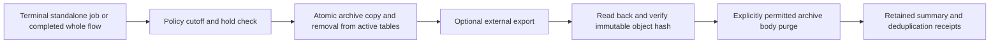

# Retention automation and additional providers

Status: retention implemented on SQLite/PostgreSQL, 2026-10-10; SQL Server implemented and native CI verified; expanded load/restore qualification and Oracle remain pending. The maintainer requested cleanup/archiving and additional providers. This plan complements [MCP operations](mcp-operations.spec.md) and [current retention semantics](../docs/operations-and-retention.md).

## Current capability and intended result

| Area | Implemented today | Planned addition |
|---|---|---|
| Active execution cleanup | Atomic archive of whole terminal units; opt-in fenced hosting with status/failures | Large contention and restore qualification |
| Eligibility | Persisted policy revisions, holds, separate outcome durations, 1–10 units, stable batch progress | Named presets |
| Archive storage | Same-database packages/summaries, verified directory export and opt-in body purge | Original-outcome and individual archived-step lookup index |
| Evidence protection | Active/Paused/Incident flows remain live; receipts survive archival/purge | Explicit policy for other growing tables without weakening deduplication |
| Event cleanup | Opt-in bounded trimming respects subscribers, live work and holds; positions are visible | Production subscriber/backlog qualification |
| Database providers | SQLite, PostgreSQL; SQL Server verified on the initial Linux x64 matrix | Oracle after portability and migration proofs |

Archive location is independent of execution outcome. A successful archived job is still successful. Archiving is neither a backup nor a way to resume an old run. Live flow dependencies stay in one store.

## Retention lifecycle

Enable maintenance explicitly in Hosting, independently of processor workers, the dashboard and MCP. A library-owned hosted service performs maintenance through the existing administrative use cases. It does not create a new ordinary job for each cleanup tick, which would itself grow the execution history. A web host or generic worker can run it; a designated maintenance-only host can also be used.

Use a database-backed maintenance lease/checkpoint to coordinate multiple instances. Its fencing token must be checked in the same transaction as each maintenance batch. The claim/completion path remains unchanged. Each batch is short, bounded by units/bytes/time, cancellation-aware and restartable. Persist the batch command ID before execution so a lost response is reconciled using its receipt. Attribute automation to a configured trusted service actor, policy revision and maintenance run ID. Policy edits require authorization, optimistic concurrency and audit.

The current archive selection is repeated inside its write transaction; a preview is advisory. Keep that property. Add holds checked in the same transaction as archive and purge. Oversized or otherwise unprocessable candidates must become visible maintenance incidents; leave their data intact, report them, and permit later eligible units to proceed through a deliberate checkpoint/exclusion mechanism. Do not silently drop evidence to make a package fit.

Suggested opt-in example preset, not an enabled default: keep successful work active for seven days, terminal failures/cancellations/rejections/expiry for 30 days, and archive bodies for 90 days after archival. All durations are configurable. Keep failed work by default when no failure cutoff is supplied. The archive-body duration never authorizes deletion without a configured, verified export and purge policy. Operators can retain bodies indefinitely or place an execution on hold.

Do not apply one retention duration to every table:

| Data | Proposed rule |
|---|---|
| Active, waiting, paused or incident work | Retain until a permitted terminal transition; no age-based deletion |
| Terminal standalone execution | Archive as one unit after its outcome-specific cutoff and hold check |
| Completed flow | Archive all steps, pinned definition evidence, signals and attempts together |
| Archive body | Purge only under explicit policy after verified external-copy evidence and hold check |
| Archive summary / lookup index | Preserve searchable location, original outcome, IDs and body availability; any future expiry must report lost coverage |
| Job/flow/signal/outbox acceptance receipts | Retain initially; later expiry requires a separate documented deduplication horizon covering producer retries and restore windows |
| Administrative command receipts | Retain initially; removing them can make an old repeated command act again |
| Audit evidence | Independent operator/security retention; ordinary job cleanup cannot delete it |
| Event journal | Trim only below all required subscriber positions and after affected executions are archived; report stalled subscribers |
| Definition versions | Keep all referenced versions; retirement alone is not deletion |

Receipts and some metadata still grow under this proposal. Do not advertise fixed database size. A future receipt-expiry feature must make its changed duplicate-acceptance guarantee explicit and prevent expired producers/commands from silently re-entering the retained namespace. Similarly, privacy deletion needs its own policy for exported copies, backups and retained identifiers.

## External archives and physical storage

Start with the existing same-database archive. Add an optional destination port only when automatic export is implemented; avoid building multiple archive backends before one end-to-end recovery proof. Use immutable object identity and a durable manifest recording store/archive ID, archive format, byte length, SHA-256, destination version and verification time. Destinations are operator-configured, not supplied by an AI tool.

Upload can succeed while acknowledgment fails. Retrying the same immutable export must verify/reuse the existing copy. Persist verified-copy evidence before a later database transaction purges its matching body. If upload, read-back or receipt persistence fails, retain the body. No distributed transaction is required. Encrypt/protect archive contents as payload data; ordinary MCP reads expose a projected index, not a large export or secret-bearing signed download URL.

Moving records into an archive table reduces active-query volume, not necessarily database file size. PostgreSQL vacuum, SQLite checkpoint/vacuum, SQL Server file maintenance and Oracle segment maintenance have different operational requirements. Keep physical maintenance in provider-specific runbooks outside worker claim transactions. Do not schedule automatic database shrinking as generic job cleanup.

Splitting active flows across databases or transparently moving a running store to another provider is outside this feature. Cross-provider migration needs an export/import compatibility contract, paused writers, receipts and external-effect reconciliation.

## SQL Server, then Oracle

Add optional `WorkThrough.Storage.SqlServer` and `WorkThrough.Storage.Oracle` packages. Each must implement the full supported persistence contract, including flows, schedules, aliases, signals, receipts, diagnostics, audit and archives. Unsupported capabilities must fail explicitly; no fallback to another provider or weaker semantics.

The shared relational implementation currently contains SQLite/PostgreSQL-specific DDL, `ON CONFLICT`, `LIMIT`, parameter syntax, numeric readers and a transactional schema upgrade assumption. Extract focused internal seams for schema migration, statements, parameter/value mapping, database time and transaction/lock behavior. Retain shared state transitions where useful. A general query-builder framework or generic repository is unnecessary.

| Concern | SQL Server design spike | Oracle design spike |
|---|---|---|
| Driver | `Microsoft.Data.SqlClient` | `Oracle.ManagedDataAccess.Core` |
| Admission serialization | Transaction-owned, store-scoped application lock; handle every lock failure/timeout | Lock a provisioned singleton admission row; avoid requiring privileged lock packages for runtime users |
| Clock | Database UTC, existing millisecond eligibility/lease rounding contract | Database UTC, same precision and rounding contract |
| Schema | Provider-specific DDL, bounded key types and appropriate nullable unique indexes | Provider-specific DDL and resumable migration journal; DDL cannot be assumed to roll back with data |
| Equality | Explicit identity equality, independent of database default collation | Explicit identity equality and preservation/validation of empty versus null values |
| Binding/mapping | Explicit parameter types/sizes and large-count conversion | Named binding, numeric/LOB mapping and bounded reads |
| Read consistency | Verify a consistent-read strategy for multi-query inventory | Verify transaction-level consistency for multi-query inventory |

These are proposals to prove, not backend guarantees already implemented. Preserve case sensitivity, trailing-space distinctions, Unicode, null behavior and maximum supported identity lengths across every provider. If a physical type cannot express the current contract, solve the representation or reject configuration before acceptance; never silently reinterpret a stored identity.

Oracle migrations need explicit interrupted-upgrade detection and resumability because DDL commits implicitly. Use a migration credential distinct from runtime DML access; workers must refuse a partially upgraded schema. SQL Server's nullable unique keys and database collations also need deliberate treatment. Vendor references: [SQL Server application locks](https://learn.microsoft.com/en-us/sql/relational-databases/system-stored-procedures/sp-getapplock-transact-sql), [unique indexes](https://learn.microsoft.com/en-us/sql/relational-databases/indexes/create-unique-indexes), [Oracle transaction semantics](https://docs.oracle.com/en/database/oracle/oracle-database/19/cncpt/transactions.html), [named binding](https://docs.oracle.com/en/database/oracle/oracle-database/26/odpnt/ConnectionBindByName.html) and [empty-string/null behavior](https://docs.oracle.com/en/database/oracle/oracle-database/18/sqlrf/Nulls.html).

Freeze an explicit server/edition/driver/OS matrix during each spike. A developer database or container does not establish support for every managed/cloud edition. Keep .NET 8 minimum and execute the existing .NET 8/10 package consumers. Azure SQL and additional Oracle deployment forms become supported only after their own relevant tests. See [ADR-012](../docs/adr/0012-retention-and-provider-expansion.md).

## Functional requirements (EARS)

- STO-001: When configured retention maintenance runs, the engine shall archive only eligible terminal units after checking outcome cutoffs and holds within the same transaction.
- STO-002: When a flow is archived, the engine shall preserve its complete bounded evidence and remove its active records atomically without archiving individual active dependencies.
- STO-003: If a candidate exceeds supported bounds, maintenance shall retain it, record an actionable incident and continue other eligible work through a bounded recovery mechanism.
- STO-004: When multiple maintenance hosts run or a host restarts, the engine shall use fenced coordination, stable batch command IDs and receipts to avoid conflicting batch effects.
- STO-005: When an archive body is purged automatically, the engine shall require a matching verified export receipt, permitted policy and current hold check, preserving summary and acceptance receipts.
- STO-006: When events are trimmed, the engine shall respect required subscriber progress and archived-execution boundaries within a bounded batch.
- STO-007: When an operator inspects retention, the system shall report effective policy, last run, progress, failures, exclusions and history coverage without requiring payload access.
- STO-008: When any supported provider accepts, claims or settles work, it shall preserve the existing commit, admission, ownership, idempotency and atomic-successor guarantees.
- STO-009: When a provider encounters an unknown or partially migrated schema, it shall refuse worker operation with a diagnostic result rather than continue with mixed schema semantics.
- STO-010: When a provider is selected, the engine shall preserve stable identities and data comparison semantics independently of backend defaults and CLR locations.

## Non-functional requirements and acceptance

Retain the current maximum of ten archive units per transaction until measurements justify a change. An archive unit can contain many jobs; count, byte and evidence limits all apply. Maintenance must yield between batches and back off under contention. Add a configurable duty/time budget, not an unbounded loop in a worker claim. Measure disk/log growth, lock waits, queue latency and memory alongside throughput. Automatic cleanup must remain disabled until its policy is configured.

Run the same contention workload with and without maintenance on each provider. Proposed initial gate: under 10% worker-throughput degradation at the configured maintenance budget, with unchanged concurrency/idempotency assertions. Include a backlog of large flows, an oversized oldest candidate, lagging subscribers and repeated restart. Report hardware, dataset, parameters and raw results; adjust the duty budget based on evidence rather than weakening durability.

| Given | When | Then |
|---|---|---|
| Completed and incident flows share a correlation ID | Maintenance runs | Only eligible completed whole flows move; the incident and its dependencies stay live |
| A hold or recovery races with a candidate preview | The archive transaction executes | Current state/hold wins; preview never authorizes stale deletion |
| Two maintenance hosts and a lost commit response | They resume the same batch | One logical effect and its receipt/audit remain; stale ownership cannot act |
| A successful archive then body purge | An old identical enqueue/start is retried | The retained acceptance receipt prevents duplicate work |
| External upload succeeds but receipt save fails | Maintenance restarts | Body remains until the immutable export is verified and durably recorded |
| The oldest candidate exceeds bounds | Later eligible candidates exist | The blocked unit remains intact and visible while later work can progress |
| A subscriber lags behind the desired trim point | Event cleanup runs | Required events remain and the blocking subscriber is reported |
| Two independent worker processes on each real provider | Claims race at a shared maximum | Valid admitted leases stay within limits and stale tokens cannot settle |
| Case/trailing-space/Unicode/empty/null boundary fixtures | Data is accepted and queried | The documented identity/data semantics match across providers |
| Oracle upgrade is interrupted after a DDL step | Initialization/worker startup repeats | Migration resumes deliberately or refuses; no worker uses a partial schema |

## Error handling

| Condition | Required behavior |
|---|---|
| Maintenance lock unavailable | Back off, release connections and report contention; do not run unfenced |
| Oversized archive | Keep evidence, record incident and apply the documented skip/checkpoint mechanism |
| Export/hash mismatch | Retain body; fail verification and surface destination/version details without credentials |
| Provider lock timeout/deadlock | Bounded provider-specific handling; no blind replay after ambiguous commit |
| Missing migration/runtime privileges | Fail setup clearly; do not request or silently use an administrator credential |
| Unknown provider name | Fail configuration; never silently choose SQLite |
| Partial schema migration | Refuse execution and report the recorded migration step |

## Delivery checklist

- [x] R0: Persisted policy/holds and bounded maintenance status are available through `IRetentionQueries`, dashboard and MCP. Audited configuration uses `IRetentionAdministration`; manual preview stays separate.
- [x] R1: Opt-in fenced hosting, atomic bounded batches, incident exclusions and stable batch receipts are implemented and provider-tested.
- [x] R2: Immutable directory export, read-back hash verification, batch-scoped receipts, lease takeover/lost-response tests and explicit purge/event policies are implemented. Production destination durability/restore qualification remains.
- [x] P0: Extract focused provider seams; keep existing SQLite/PostgreSQL conformance and saved-schema tests passing.
- [x] P1: Implement SQL Server, declare its matrix and add real-instance CI, fault, retention and MCP query tests.
- [ ] P2: Prove Oracle migration/binding/locking semantics, implement Oracle and run the same full real-instance gates.
- [ ] Run independent-process races, stale-token recovery, database-time precision, lost acknowledgments, duplicate starts, aliases, branch activation, signals, schedules, audit/receipts, restore and interrupted initialization tests for each advertised backend.
- [ ] Run .NET 8/10 packaged consumers, published processor-relocation proof and performance/cleanup contention campaigns before updating support claims.

MCP read-only delivery can proceed on SQLite/PostgreSQL while provider work continues. Automatic archive deletion is not a prerequisite for MCP investigation. Receipt expiration, live database switching, arbitrary flow rewind and cross-store active-flow partitioning remain separately scoped work.
